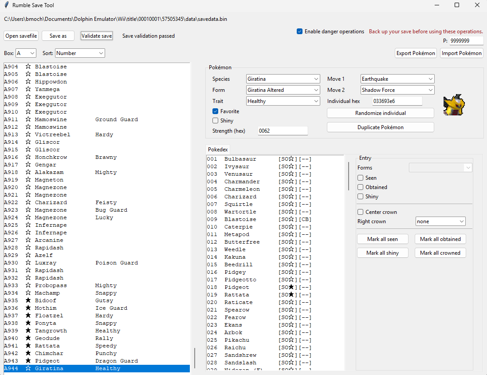

# Rumble Save Tool

A save editor for the Wii release of Pokemon Rumble. It edits Pokemon box records, the shared Pokedex, and P, then writes the result in the format Dolphin expects. Unknown bytes are preserved unless an operation explicitly changes them.

The format is based on supplied save samples and controlled Dolphin tests. It is not an official Nintendo specification. Always back up a save before editing it!

## Running from source

- Python 3.10 or newer
- Tkinter (included with the standard Windows Python installer)
- A decrypted or encrypted Wii `savedata.bin` produced by Pokemon Rumble; the tools handle the normal encrypted file automatically

The project uses only the Python standard library.

Packaged releases do not require Python. See [docs/BUILDING.md](docs/BUILDING.md)
for the maintainer build process.

## Graphical editor



Run:

```powershell
python editor_gui.py
```

The editor opens Dolphin's default save location for the current operating
system when a save exists:

```text
Windows: %USERPROFILE%\Documents\Dolphin Emulator\Wii\title\00010001\57505345\data\savedata.bin
macOS:   ~/Library/Application Support/Dolphin Emulator/Wii/title/00010001/57505345/data/savedata.bin
Linux:   ~/.dolphin-emu/Wii/title/00010001/57505345/data/savedata.bin
```

The box editor supports species, form, moves, traits, favorite/shiny flags, strength, individual bytes, duplicating records, and transferring a selected Pokemon between saves. The box list can be kept in box-number order, sorted by species name or Pokédex order, or sorted with favorited Pokémon first. Export creates a portable `.pokemon.json` record; import appends it to the currently selected box. Platinum-derived valid moves for the selected species are grouped first and shown in green. The Pokedex tab supports seen, obtained, shiny, form, and crown flags, including bulk actions. **Validate save** checks the loaded save's checksum and box structure.

## Command-line editor

Edit a Pokemon or Pokedex entry:

```powershell
python save_editor.py edit-pokemon saves/savedata.bin edited.bin --slot A --index 0 --trait 7 --favorite
python save_editor.py edit-dex saves/savedata.bin dex-edited.bin --species 479 --obtained --seen --forms 0x3f
python save_editor.py validate saves/savedata.bin
```

If a command-line output file already exists, the editor asks before replacing it. Answer `y` or `yes` to continue; any other answer leaves the file unchanged. The GUI uses **Save as**.

## Save format summary

- Files are 0x34000 bytes and contain three save slots: A, B, and C.
- A box record is 45 bytes (0x2D).
- The first 20 bytes are a SHA-1 over the remaining data.
- Box species/forms, moves, traits, favorite, shiny signature, and individual-value fields are documented in [docs/SAVE_STRUCTURE.md](docs/SAVE_STRUCTURE.md).
- The Pokedex is shared between the three save slots and moves when box lengths change.

The structure notes distinguish confirmed fields from hypotheses. Please report new findings with the original save, the edited save, the exact in-game action, and the affected record or offset.

To validate source syntax before packaging, run `python -m compileall .`.

## References

- **Pokémon icons:** [SciresM/Rumble-World-Save-Tool resources](https://github.com/SciresM/Rumble-World-Save-Tool/tree/master/Pokemon%20Rumble%20World%20Save%20Tool/resources/img)
- **Species list and names:** [Serebii Pokémon Rumble list](https://www.serebii.net/melee/pokemon.shtml)
- **Trait descriptions:** [Bulbapedia — Special Traits](https://bulbapedia.bulbagarden.net/wiki/Special_Traits)
- **Save-format research and related tooling:** [KooShnoo/pokemon-rumble](https://github.com/KooShnoo/pokemon-rumble)

## Browser editor and GitHub Pages

The browser editor supports editing Pokémon fields, P, and shared Pokédex entries. Open a Pokémon Rumble Wii `savedata.bin`, apply changes, and download the result. Processing stays in the browser; no save is uploaded. The desktop editor provides additional features such as duplication, transfer, and bulk operations.

To preview locally, run `python -m http.server` from the repository root and visit `http://localhost:8000/`. Web Crypto requires localhost or HTTPS.

The included GitHub Actions workflow publishes the static site when changes are pushed to `main` (or when run manually). In the repository's **Settings → Pages**, set **Source** to **GitHub Actions**. If the default branch has another name, update the branch in `.github/workflows/pages.yml`. Once the workflow completes, GitHub displays the site URL in the Pages settings.
